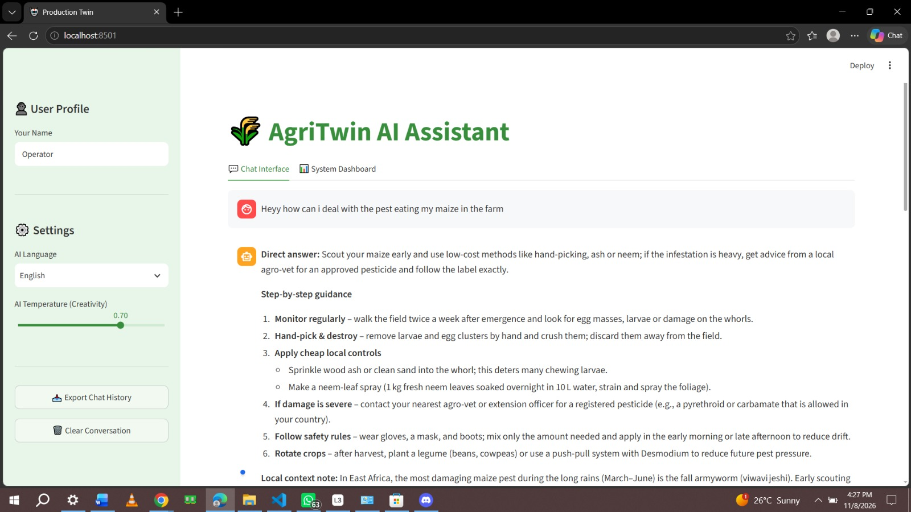
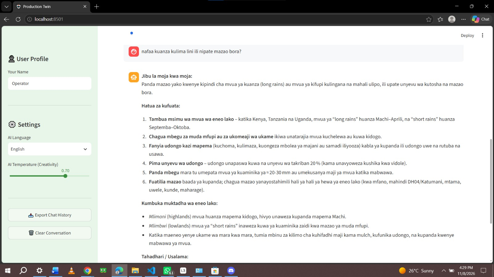

# 🌾 AgriTwin AI Assistant

An AI assistant that helps farmers get answers to agricultural questions, built as the final project of a digital twin course.

## What it does
- Answers farming questions using a knowledge base of agricultural manuals (RAG)
- [Add 2–3 real features, e.g. what topics it covers, safety checks, logging]

## Demo
🔗 **Live demo:** https://agri-twin-ai-dmfsqduzdb4dacj28gtaad.streamlit.app

**Asking in English**



**Asking in Kiswahili**



## What it does
- Answers farming questions from a knowledge base of agricultural manuals using RAG
- Understands and replies in both English and Kiswahili
- Works as a Streamlit web app and as a WhatsApp bot (Twilio + Flask)
- [one line about the safety check / logging]

## How it works
1. Documents (`agri_manual.txt`, `twin_manual.txt`) are split into chunks
2. When a farmer asks a question, the most relevant chunks are retrieved using keyword matching
3. A Groq-hosted LLM generates an answer using only those chunks, which reduces hallucinations
4. [what safety_violations.log records]

## Tech stack
Python, Streamlit, Groq LLM, Flask, Twilio (WhatsApp), ngrok

## Run it locally
```bash
git clone https://github.com/risaa8819/farmer-ai-assistant.git
cd farmer-ai-assistant
pip install -r requirements.txt
streamlit run app.py
```
Add your API key in `.streamlit/secrets.toml`:
```toml
[YOUR_KEY_NAME] = "your-key-here"
```

## What I learned, challenge i faced , what to improve 
· What I Learned: I learned how to build a full-stack AI application by connecting a Streamlit frontend, a Groq LLM backend, and custom RAG (Retrieval-Augmented Generation) to prevent hallucinations. I also learned how to bridge Python to WhatsApp using Twilio, Flask, and ngrok.
· The Challenge: The hardest part was securing API keys and managing the local webhooks. Debugging the ngrok tunnels and Twilio connections taught me a lot about real-world deployment security.
· What I'd Improve: Next, I want to upgrade the RAG system from keyword matching to true vector embeddings, and host the WhatsApp bot on a permanent cloud server so it can run 24/7 without relying on my local computer.

## Author
[RISPER MUMBI ] · [LinkedIn] [www.linkedin.com/in/risper-mumbi-b51a0a394]